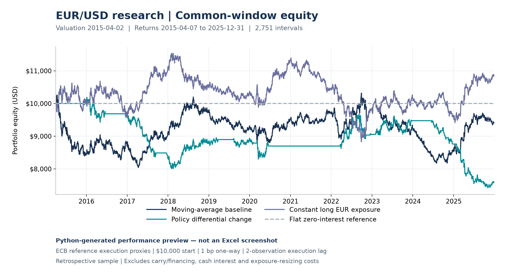
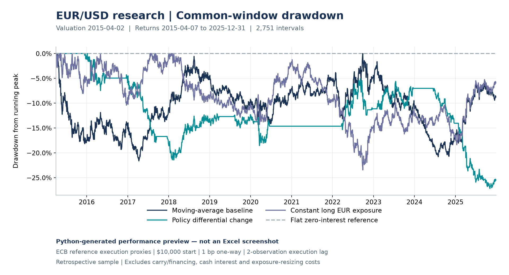

# EUR/USD Macro FX Research

A reproducible Python research pipeline comparing moving-average and policy-rate
signals with long EUR exposure and a flat reference, with an auditable Excel
reporting snapshot.

Built end to end: ECB FX and FRED policy-rate collection and alignment; two fixed
signals; delayed execution and transaction costs; net-return and risk metrics;
benchmarks; bounded cost/delay checks; and a five-sheet Excel dashboard.

## Results

The common window starts from **$10,000 cash on 2015-04-02**, with **2,751 return
intervals from 2015-04-07 through 2025-12-31**. All portfolios use the same dates,
1-bp one-way turnover costs, final liquidation treatment, and metric definitions.
Strategy signals become held positions after a **two-observation shift**.

| Portfolio | Total return | CAGR | Annualized volatility | Zero-reference Sharpe | Max drawdown loss |
|---|---:|---:|---:|---:|---:|
| Moving-average baseline | -5.94% | -0.57% | 7.80% | -0.033 | 21.62% |
| Policy differential change | -24.14% | -2.54% | 5.75% | -0.411 | 27.17% |
| Constant long EUR exposure | 8.47% | 0.76% | 7.80% | 0.134 | 23.44% |
| Flat zero-interest reference | 0.00% | 0.00% | 0.00% | Undefined | 0.00% |

**Both tested strategies underperformed constant long EUR exposure in this
retrospective sample.** No profitable-trading or out-of-sample claim is made.
Sharpe assumes a zero reference rate; maximum drawdown is a positive loss magnitude.

### Python-generated performance previews

These are Matplotlib plots of the saved common-window results, **not Excel
screenshots**. All 2,752 valuation observations per portfolio are retained.





## Reproduce the project

Tested with **Python 3.14.3 on macOS Apple silicon**. From a fresh checkout:

```sh
git clone https://github.com/Estifanos-Wassie/macro-fx-backtest.git
cd macro-fx-backtest
python3.14 -m venv .venv
.venv/bin/python -m pip install -r requirements.txt
.venv/bin/python -m unittest discover -s tests -v
.venv/bin/python run_pipeline.py --download
```

The explicit download mode retrieves real ECB/FRED data and records source URLs,
UTC retrieval times, and hashes. It refuses to replace existing snapshots unless
you request `--download --refresh`; earlier raw bytes remain archived. Use a
separate checkout to compare a new source vintage with established results.

For existing snapshots:

```sh
.venv/bin/python run_pipeline.py --offline
```

**Ignored raw snapshots must first be obtained** from a prior download or copied
from a fixed-snapshot archive. Offline mode needs `data/raw/eurusd_ecb.csv` plus
the FRED CSVs and complete timestamped metadata under `data/raw/policy_rates/`.
It never invokes download stages. Dependency installation is a separate setup
step that may require network access.

Verification completed in an isolated environment: **64 tests passed without
ignored data**; the full offline pipeline ran with networking blocked; all
**14 analytical CSV outputs were byte-identical** to the established results.
A separate live-download run also matched the fixed snapshot at verification
time. Later current-vintage downloads can differ. See [reproduction details,
snapshot selection, and the output inventory](docs/reproducibility.md).

## Excel dashboard and preview refresh

The pipeline produces **`reports/macro_fx_dashboard.xlsx`** with Dashboard,
Performance, Signals, Robustness, and Methodology sheets. The workbook includes
native charts, formulas with verified caches, and input provenance; it needs no
external files, macros, or running Python when viewed.

```sh
.venv/bin/python src/build_dashboard.py
.venv/bin/python src/generate_previews.py
```

These commands use saved verified outputs; they do not rerun the analytical
pipeline. Changing assumptions requires rerunning the relevant Python stages.
See [dashboard generation and verification](docs/dashboard.md). The earlier
uploaded workbook was independently checked and rendered in LibreOffice, as
reported by the user; native Excel was not tested. **The revised two-page print
layout remains unverified in a renderer**, despite passing structural checks.

## Repository

```text
run_pipeline.py       Explicit offline/download pipeline entry point
requirements.txt      Pinned dependencies
src/                  Data, signals, simulation, evaluation, and reporting
tests/                Synthetic-fixture and workbook verification tests
docs/                 Methodology, robustness tables, and reproduction evidence
docs/assets/          Deliberately tracked Python-generated preview images
data/                 Ignored raw snapshots and analytical outputs
reports/              Ignored generated Excel workbook
```

## Scope and limitations

The source data contain **2,816 ECB EUR/USD reference observations** (USD per
EUR, 2015-01-02–2025-12-31) and **4,383 daily observations per FRED policy series**
(2014-01-01–2025-12-31): ECBDFR, DFEDTARL, and DFEDTARU. The fixed signals use
20/60-observation SMAs and a 63-observation change in the ECB-minus-Fed policy
differential. Neither rule was tuned or reversed to improve results.

Policy history is current vintage. Source date + one calendar day is assumed
availability, not a verified historical publication time; revision risk remains.
ECB reference rates are execution proxies, not guaranteed fills. The stylized
daily exposure model excludes financing/carry, cash interest, and daily resizing
costs. Long EUR is equity-relative exposure, not fixed-quantity currency holdings;
flat is a zero-interest reference, not historical cash performance. The macro
signal is not carry income. These are retrospective diagnostics, not causal
prediction, live deployment, or holdout validation.

- [Detailed methodology, formulas, sources, and timing](docs/methodology.md)
- [Complete cost, delay, and annual-return tables](docs/robustness.md)
- [Fixed-snapshot reproducibility and verification evidence](docs/reproducibility.md)
- [Excel dashboard build, contents, and rendering limitations](docs/dashboard.md)
